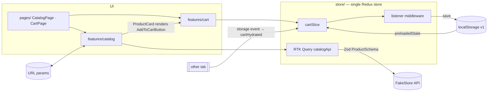

# Shopping Cart Web Application

A production-grade shopping cart SPA built on the [FakeStore API](https://fakestoreapi.com/products). It has a filterable, paginated catalogue and a cart that persists across reloads and syncs between tabs.

**Live demo:** <https://shopping-cart-web-application-axqo.vercel.app/>

**Docs:** [ADR-001 State management](docs/adr-001-state-management.md) · [Performance notes](docs/performance-notes.md) · [Testing strategy](docs/TESTING.md) · [Security](docs/SECURITY.md)

**Stack:** React 19 · TypeScript (strict, `noUncheckedIndexedAccess`, `exactOptionalPropertyTypes`) · Vite 6 · Redux Toolkit + RTK Query · React Router 7 · Zod 4 · Tailwind CSS v4 · Vitest + React Testing Library + MSW · Playwright + axe

## Quick start

Requires **Node ≥ 22.13** (see `.nvmrc`).

```bash
npm ci
npm run dev            # http://localhost:5173
```

| Script                                      | What it does                                                              |
| ------------------------------------------- | ------------------------------------------------------------------------- |
| `npm run dev`                               | Dev server with HMR                                                       |
| `npm run build`                             | Type-check, then production build to `dist/`                              |
| `npm run preview`                           | Serve `dist/` with the **production security headers**                    |
| `npm run lint`                              | ESLint (type-aware, a11y, architecture boundaries), zero warnings allowed |
| `npm run format` / `format:check`           | Prettier, with Tailwind class sorting                                     |
| `npm run typecheck`                         | `tsc -b --noEmit`                                                         |
| `npm test` / `test:watch` / `test:coverage` | Vitest (unit + integration), with coverage gates                          |
| `npm run e2e:install`                       | Download the Playwright browsers (first time only)                        |
| `npm run e2e`                               | Build, serve and run Playwright on 6 browser/device projects              |
| `npm run audit:prod`                        | Fail on high or critical advisories in shipped dependencies               |
| `npm run ci`                                | lint → typecheck → test:coverage → build → e2e                            |

Configuration: copy `.env.example` to `.env` to point at another API. `VITE_API_BASE_URL` must be https. Everything prefixed `VITE_` is public.

## Features

**Catalogue**

- Responsive grid; each card lays itself out with container queries.
- Category filter, debounced search, five sort orders and numbered pagination. All of it lives in the URL, so views are shareable and the back button works.
- Distinct loading (skeleton), error (with Retry), empty-catalogue and no-matches (with Clear filters) states.

**Cart**

- "Add to cart" turns into an inline quantity stepper.
- A header badge on every page.
- A cart page with line totals, subtotal, remove, and "Clear cart" with confirmation.

**Resilience**

- Live prices are used when available, and price changes are flagged.
- Products that left the catalogue are flagged and excluded from the total.
- If storage is blocked or full, the cart keeps working in memory.

**Persistence:** the cart is saved in `localStorage` in a versioned, validated format. It survives reloads and restarts and syncs across tabs.

**Accessibility (WCAG 2.2 AA target)**

- Landmarks, a skip link, and focus management on route changes, pagination and removal.
- Live-region announcements and labelled controls with label-in-name.
- `aria-disabled` limits that explain themselves.
- Native `<dialog>` and `<select>` controls; reduced-motion support; dark mode.

## Architecture



| State                             | Owner                         | Persistence                           |
| --------------------------------- | ----------------------------- | ------------------------------------- |
| Product catalogue                 | RTK Query `catalogApi`        | In-memory cache, 5 min                |
| Category / search / sort / page   | URL search params             | URL                                   |
| Cart lines                        | `cartSlice`                   | `localStorage`, versioned + validated |
| Search draft, mobile filter panel | Local `useState`              | None                                  |
| Screen-reader announcements       | `announce()` → `<LiveRegion>` | None                                  |

```
src/
  app/        composition root: App, router (lazy routes), Layout, providers
  store/      the only place that knows every slice; cart × catalogue pricing join
  pages/      thin route components that compose features
  features/
    catalog/  api (RTK Query + Zod), model (pure filter/sort/paginate), hooks, components
    cart/     model (slice, selectors, schema, policies, pricing), persistence, hooks, components
  shared/     config/env, lib (money, safeStorage, safeUrl, announce, …), ui (Button, ErrorState, …)
  test/       MSW server, fixtures, renderWithProviders
e2e/          Playwright specs
docs/         adr-001-state-management, performance-notes, TESTING, SECURITY
```

**Boundaries are enforced by ESLint:**

- `shared` imports nothing above it.
- Features talk to each other only through their `index.ts`.
- `cart` never imports `catalog`.

**Scaling path:** a new feature adds `features/<name>/` with its own slice (or RTK Query API) and listeners, then registers in `combineSlices` or injects itself lazily. No existing feature changes.

## Key decisions

- **Redux Toolkit + RTK Query.** One store and one data layer that scales to more features. Full reasoning is in [ADR-001](docs/adr-001-state-management.md).
- **URL as state** for the catalogue view, so filters survive reload, can be shared and work with Back.
- **Zod at every trust boundary:** API, storage, URL and env. See [SECURITY.md](docs/SECURITY.md).
- **Large catalogues:** pagination behind a repository seam (see below).
- **Cart persistence:** listener middleware writes to versioned `localStorage`, with cross-tab sync and no echo loop.
- **Integer-cent money:** 3 × $19.99 = $59.97 exactly.

### Large catalogues: pagination, not virtualization

FakeStore returns 20 products. A real catalogue could have thousands, so the listing is built as if
it did: **numbered pagination, 12 per page, with the page number in the URL**.

The UI never filters the full list itself. It asks a repository for one page:
`getCatalogPage({ category, q, sort, page, pageSize })` returns that page's items plus totals.
FakeStore can't filter, sort or paginate, so today that endpoint runs a pure pipeline
(`buildCatalogPage`) over the cached product list. For a real backend, the `queryFn` becomes
`query: (q) => ({ url: '/products/search', params: q })`. Hooks, components and URL state don't
change, and RTK Query caches each page separately.

Why pagination over the alternatives:

| Option                                   | Why not (for this product)                                                                                                                                                                                                                                                                                                              |
| ---------------------------------------- | --------------------------------------------------------------------------------------------------------------------------------------------------------------------------------------------------------------------------------------------------------------------------------------------------------------------------------------- |
| **Virtualization** (e.g. `react-window`) | It solves DOM size, not data size: the client still has to download and hold the whole catalogue to filter and sort it. Items outside the viewport aren't in the DOM, so browser find-in-page, screen-reader list counts and keyboard focus on unmounted items all break. A 12-card responsive grid is nowhere near a DOM-size problem. |
| **Infinite scroll**                      | Back after opening a product loses your position unless scroll is restored carefully. The footer becomes unreachable. "Page 3 of electronics" can't be shared. Screen-reader and keyboard users get content appearing with no clear boundary.                                                                                           |
| **Pagination (chosen)**                  | Maps directly onto server-side paging (`?page=&pageSize=`). Every view has a URL. Each page is a small, fixed amount of DOM. On page change, focus moves to the results heading so keyboard and screen-reader users know where they are.                                                                                                |

The trade-off is more clicks when browsing a long list. If analytics showed people mostly scroll
rather than search or filter, the next step would be a "Load more" button that appends the next
server page and keeps the page in the URL. Virtualization would only come in if a single page had
to show hundreds of rows.

### Cart failure scenarios handled

| Scenario                         | Handling                                                                                                                                                                                                                                                               |
| -------------------------------- | ---------------------------------------------------------------------------------------------------------------------------------------------------------------------------------------------------------------------------------------------------------------------- |
| Rapid repeated clicks            | Each click is one synchronous Redux action applied to the latest state, so there's no lost or doubled update. The reducer clamps at the limit (unit test: ten rapid increments).                                                                                       |
| Stale state across tabs          | Another tab's write arrives as a `storage` event, is re-validated and replaces this tab's cart. Resolution is last write wins, with no merge. Hydrating isn't persisted, so tabs don't echo writes back and forth (E2E: `cross-tab.spec.ts`).                          |
| Adding beyond stock              | FakeStore has no stock field, so the limit is 10 per line. The model accepts a `stock` value and uses the lower of the two when present. "+" is `aria-disabled` with a visible reason, and the reducer clamps too. Real stock must be checked server-side at checkout. |
| Price changed since adding       | The total uses the live price, and the line says "price updated from $X".                                                                                                                                                                                              |
| Product removed from catalogue   | Flagged "No longer available", excluded from the total, and only Remove is offered.                                                                                                                                                                                    |
| Tampered or corrupted storage    | Per-line validation, clamping, key re-derivation and a 100 kB cap. Stored prices are never used for totals when live prices exist.                                                                                                                                     |
| Storage blocked or full          | Falls back to memory, with a one-time notice.                                                                                                                                                                                                                          |
| Catalogue fails on the cart page | The cart renders from snapshots, with a "prices may be out of date" banner and Retry.                                                                                                                                                                                  |
| Accidental "Clear cart"          | A native `<dialog>` asks for confirmation. Cancel is focused first.                                                                                                                                                                                                    |

## Quality gates

- **Tests:** 224 unit and integration tests (Vitest), plus 11 Playwright tests per browser project. Details are in [docs/TESTING.md](docs/TESTING.md).
- **Coverage:** 98.4% lines and 93.8% branches overall. The cart, catalogue model and shared libs are at 98–100% lines. CI enforces thresholds of 80/75 globally and 95/90 for core logic. The report is uploaded as a CI artifact. Breakdown and reasoning are in [docs/TESTING.md](docs/TESTING.md#coverage).
- **Accessibility:** axe scans show zero serious or critical violations on the catalogue, cart, empty cart and error states.
- **Security:** a CSP with no `unsafe-inline`, verified in E2E. `npm audit` reports 0 vulnerabilities. Details are in [docs/SECURITY.md](docs/SECURITY.md).
- **Bundle:** split into vendor chunks. Roughly gzipped: React 69 kB, router 31 kB, Redux 29 kB, Zod 26 kB, app code 15 kB, all routes lazy-loaded. Hashed assets are cached immutably. Lighthouse Performance is 100 on the deployed build. See [docs/performance-notes.md](docs/performance-notes.md).

## Deviations from the implementation plan

- **Zod 4 and Vitest 4.** These replace Zod 3 and Vitest 3, which have security advisories.
- **Built-in `no-restricted-imports`.** It replaces `eslint-plugin-boundaries`.
- **Small accessibility refinements.**
