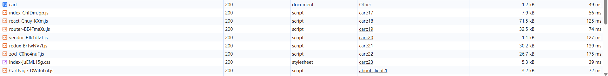
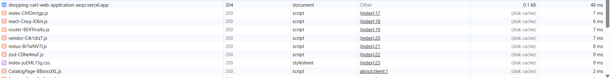

# Performance notes

Deployed build: <https://shopping-cart-web-application-axqo.vercel.app/>

## Summary

|                                         | Before                              | After                            |
| --------------------------------------- | ----------------------------------- | -------------------------------- |
| Lighthouse Performance (production URL) | 81                                  | 100                              |
| Document on repeat visit                | `200`, 1.2 kB                       | `304 Not Modified`, 0.1 kB       |
| JS + CSS on repeat visit                | ~178 kB downloaded from the network | 0 bytes (served from disk cache) |
| Slowest static request on repeat visit  | 175 ms (`zod` chunk)                | 9 ms                             |

The fix is in commit `b09c10f` ("added JS bundle, asset initial load cache on refresh").

## What I found

On every reload, the browser downloaded the whole app shell again: the HTML document, all
vendor chunks (`react`, `router`, `redux`, `zod`, `vendor`), the app entry, the CSS and the
route chunk. Nothing was served from cache, even though Vite already gives every file under
`/assets/` a content hash in its name and nothing in those files had changed.



| Request           | Transfer | Time   |
| ----------------- | -------- | ------ |
| `cart` (document) | 1.2 kB   | 49 ms  |
| `index-*.js`      | 7.9 kB   | 56 ms  |
| `react-*.js`      | 71.5 kB  | 125 ms |
| `router-*.js`     | 32.5 kB  | 74 ms  |
| `vendor-*.js`     | 1.1 kB   | 127 ms |
| `redux-*.js`      | 30.2 kB  | 139 ms |
| `zod-*.js`        | 26.7 kB  | 175 ms |
| `index-*.css`     | 5.3 kB   | 39 ms  |
| `CartPage-*.js`   | 3.2 kB   | 72 ms  |

Three things caused this:

1. **No explicit cache policy split between the shell and hashed assets.** `index.html` must
   always be revalidated, because it is the one file that points at the new hashed chunks after
   a deploy. Hashed files under `/assets/` never change, so they can be cached for a year. The
   config didn't separate the two clearly.
2. **Unhashed static files.** `favicon.svg` and `placeholder.svg` lived in `public/`. Vite copies
   that folder as-is, so those files had stable names. They could never be cached long-term
   without the risk of serving a stale version after a change.
3. **Inlined assets fought the CSP.** Vite inlines small assets as `data:` URLs by default. The
   Content-Security-Policy (`img-src 'self' https://fakestoreapi.com`) blocks `data:` images, so
   inlining was not a safe way to avoid the extra request either.

## How I diagnosed it

- **Chrome DevTools, Network panel**, against the production Vercel deployment with
  "Disable cache" off. I reloaded and looked at the Status, Size and Time columns. Every asset
  came back `200` with a real transfer size instead of `(disk cache)`.
- **Response headers** on the `/assets/*` requests and the document, to check which
  `Cache-Control` value each one actually received from Vercel.
- **Lighthouse** (Chrome DevTools, production URL) for an overall score before and after.

## What I changed

**`vercel.json`**: two cache rules. Hashed assets are immutable, and everything else (the SPA
shell) has to revalidate:

```json
{
  "source": "/((?!assets/).*)",
  "headers": [{ "key": "Cache-Control", "value": "no-cache" }]
},
{
  "source": "/assets/(.*)",
  "headers": [{ "key": "Cache-Control", "value": "public, max-age=31536000, immutable" }]
}
```

The negative lookahead `(?!assets/)` matters. Vercel merges headers from every rule that
matches, so a plain `/(.*)` rule with `no-cache` would also land on `/assets/*` and cancel the
immutable policy.

`no-cache` does not mean "don't cache". It means "cache, but check with the server first". The
document is therefore revalidated with its ETag and comes back as a `304` (0.1 kB) unless a new
deploy changed it.

**`public/_headers`**: the same `/assets/*` immutable rule, so the build behaves the same on
Netlify-style hosts. It has a comment explaining why there is no catch-all rule for `index.html`.

**Moved `favicon.svg` and `placeholder.svg` from `public/` to `src/assets/`** and import them
(`Layout.tsx`, `safeUrl.ts`, `index.html`). They now go through the bundler, get a content hash,
and fall under the immutable `/assets/*` rule:

```ts
// src/shared/lib/safeUrl.ts
import placeholderUrl from '@/assets/placeholder.svg';

// Imported (not in public/) so the build emits it as a content-hashed, long-cacheable asset.
export const PLACEHOLDER_IMAGE = placeholderUrl;
```

**`vite.config.ts`**: `assetsInlineLimit: 0`, so Vite emits real hashed files and never inlines
`data:` URLs that the CSP would block.

This builds on the existing `manualChunks` vendor split (`react`, `router`, `redux`, `zod`,
`vendor`). Vendor code changes far less often than app code, so after a deploy that only touches
app code, returning users download only the small `index-*.js` and route chunks again. The
vendor chunks stay in the immutable cache.

## Evidence of the improvement

**Network panel after**: the document is a `304`, and every script and stylesheet is served from
disk cache in 2–9 ms.



**Lighthouse before (81)**:


**Lighthouse after (100)**:


Accessibility (100), Best Practices (96) and SEO (92) did not change. The caching change only
affects performance.

## Caveats

- **Lighthouse score vs. caching.** By default, Lighthouse clears storage before an audit, so
  its run is effectively a first visit. The 81 → 100 jump should not be read purely as a
  repeat-visit caching win: run-to-run variance (network, CPU load on the machine) also feeds
  the score. The Network panel comparison is the direct evidence for the caching fix. Lighthouse
  shows that the change did not regress the first-load experience and that the deployed build
  scores well overall.

## Re-render propagation (checked by design, not changed here)

The cart state is structured so that a cart change doesn't re-render the product grid:

- Components subscribe through narrow hooks (`useCartCount`, `useCartLine(productId)`), not the
  whole cart slice. Adding a product re-renders only the header badge and that product's
  `AddToCartButton`.
- Derived values (`selectCartItemCount`, `selectCartLinesWithPricing`,
  `selectCartSubtotalCents`) are memoized `createSelector`s, so they return the same reference
  when their inputs haven't changed.
- `ProductCard` is wrapped in `React.memo`, so a parent re-render (for example, while the search
  box is typing) does not re-render every card whose product prop is unchanged.
